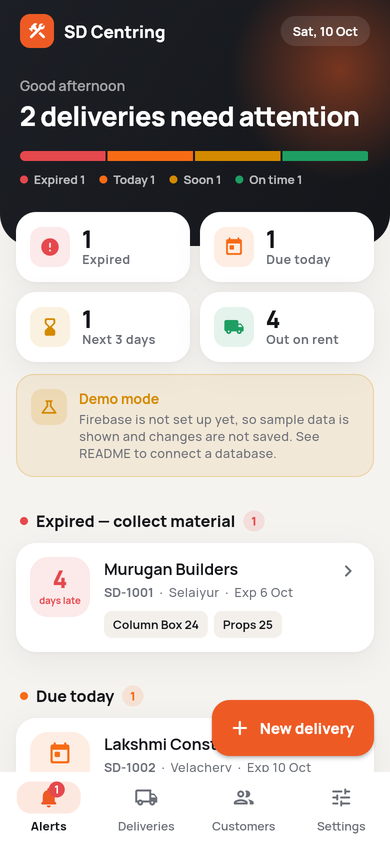
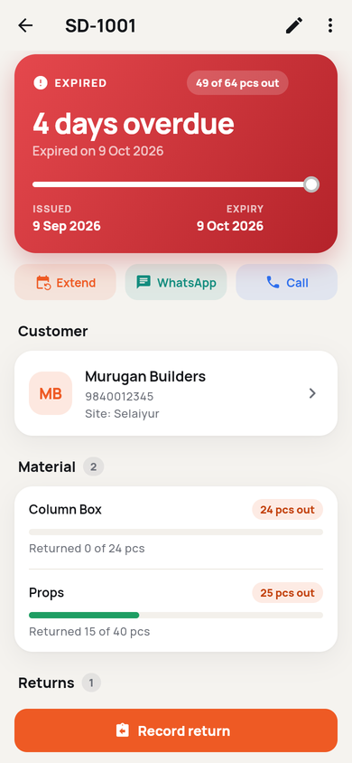
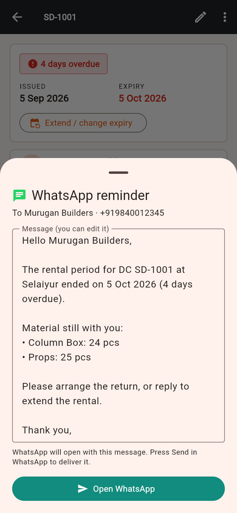
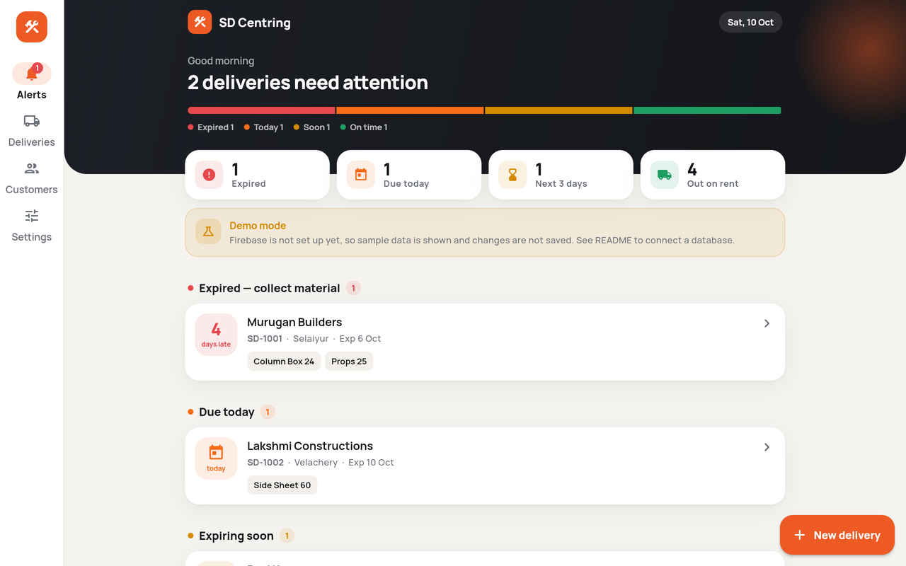

# SD Centring — rental expiry tracker

A Flutter app (Android, iOS, web) for SD Centring to track material sent to
customer sites and get **notified before rentals expire**. Unlike the PD
Centring app it has **no prices, totals, GST or invoices**: only who has what,
how much has come back, and when it is due back.

It is a separate app with its own code, database and look. Nothing is shared
with PD Centring.

| Alerts | Delivery | WhatsApp reminder | Desktop |
|---|---|---|---|
|  |  |  |  |

All 22 screens are in [`docs/screenshots/`](docs/screenshots).

## What it does

- **Alerts (home):** expired, due today, expiring soon and out-on-rent counts,
  with the deliveries that need action first.
- **Deliveries (DCs):** customer, site, delivery date, expiry date (quick
  picks: 7/15/30/45/60 days) and items with quantities. DC numbers are
  suggested automatically (`SD-1001`, `SD-1002`, …) and duplicates are refused.
- **Returns:** partial returns per item (e.g. 15 of 40 props), several at once,
  with a date and note. Any return can be undone. A delivery closes when
  everything is back.
- **Extend expiry:** every change is kept in a history.
- **Customers (the main job):** name, phone, alternate phone, address,
  notes, a profile photo (camera or gallery) and ID / address proofs
  (Aadhaar, PAN, voter ID, utility bill…) as photos or PDFs up to 10 MB, plus
  the material they currently hold and their deliveries. Customers with
  deliveries cannot be deleted. Adding a customer is built to never lose
  work:
  - Phone numbers are checked as they are saved (digits only, 10–13
    digits), and a number already used as anyone's main *or* alternate
    number is pointed out by name.
  - Nothing is written until every photo and document has uploaded. If one
    fails, the form stays open with the files still attached: **Try again**,
    **Save without them**, or **Keep editing**. After a connection failure
    the remaining files are not each left to time out.
  - What you type is kept on the phone while you work, so if Android closes
    the app while the camera is open, the details are back next time
    (photos need to be taken again).
  - Every customer row shows **In cloud** or **Not in cloud yet**, and
    whether ID proof is still missing. The customer page says when a record
    is only on this phone.
  - The list can be sorted A–Z or newest first; search covers name,
    address, phone and alternate phone.
- **Reminders on the phone:** N days before expiry (1/2/3/5/7, set in
  Settings), on the expiry day, and the day after if material is still out.
  Each reminder fires at your chosen time. Tapping one opens that delivery.
  In the browser, use the Alerts tab instead.
- **WhatsApp reminders to customers:** from a delivery, *Send WhatsApp
  reminder* shows the message (DC, site, expiry date and the material still
  out, with no prices), lets you edit it, and opens WhatsApp with it typed in.
  You press Send in WhatsApp. The app records when the last reminder was
  sent. This uses WhatsApp's free click-to-chat links, so it needs no API,
  server or cost, and carries no risk of the number being banned.
- **Photos and documents:**
  - Every image is made smaller on the phone before upload, without
    visible loss: profile photos to 1024 px (about 100–250 KB), photos of
    ID cards and bills to 2000 px (about 300–700 KB instead of 3–8 MB from
    the camera), JPEG quality 82–85, the phone's rotation applied. Images
    already small are left untouched. A 256 px thumbnail of the profile
    photo is stored for lists.
  - PDFs are uploaded exactly as they are (up to 10 MB): shrinking a PDF
    means re-rendering it, which would blur the text.
  - Uploading starts the moment a file is picked, while the rest of the
    form is filled in, with progress on each file. **Save** only waits for
    whatever is still uploading.
- **Reading the name from documents:** the ID & address proof section is
  at the top of the customer form, so staff can add the Aadhaar, PAN, voter
  ID, driving licence or bill first (photo or PDF). The customer's name is
  read from it and filled in if the name field is still empty, and the
  document type is set. A name already typed is never changed: if the
  document shows a different name, it is offered with a **Use** button;
  if it matches, the app just confirms it. The address is deliberately
  **not** read, because a bill may carry a site address rather than the
  customer's own. Addresses, ID numbers, dates of birth and phone numbers
  are never read or stored. Password-protected PDFs (e-Aadhaar) cannot be
  read; the app says so and suggests a photo or screenshot instead. In demo
  mode a sample name is shown and labelled as such.
- **Cloud sync status:** a banner says when changes are waiting to upload, when
  the phone is offline, or when the database refuses access. A failed save is
  never silent.

## Try it now (demo mode)

Until Firebase is connected the app runs in **demo mode** with sample data.
Nothing is saved in demo mode.

```bash
cd sd_centring
flutter pub get
flutter run            # phone / emulator
flutter run -d chrome  # browser
```

## Connect a database (one-time setup)

Use a **new Firebase project just for SD Centring**. Don't reuse PD Centring's.

Use a **new Firebase project for SD**, not the PD app's project: both apps
store customer files under `customers/`, and deploying one app's rules would
replace the other's.

1. Create a Firebase project, then enable **Authentication → Email/Password**
   and **Firestore Database** (choose *production mode*, not test mode), and
   **Storage** (for customer photos and documents).
2. In `sd_centring/`, run `flutterfire configure --project=<project-id>`.
   This replaces `lib/firebase_options.dart`.
3. Deploy the security rules: `firebase deploy --only firestore:rules,storage`
   (again after every app update that changes `firestore.rules` or
   `storage.rules`; the customer rules check the same limits as the form)
   (rules are in `firestore.rules` and `storage.rules`; both allow staff only).
4. Add each staff member:
   - **Authentication → Users → Add user** (email + password).
   - **Firestore → start collection `staff` → document ID = that user's UID**
     (any field, e.g. `name: "Owner"`). Accounts not in `staff` cannot read
     or write anything, even if they sign in.

There is no public sign-up screen. Accounts are created only by the owner.

5. Turn on document reading (optional, for filling the customer's name
   from an uploaded Aadhaar, PAN, voter ID or bill):
   - Firebase console → **AI Logic** → **Get started** → choose the
     **Vertex AI Gemini API** (needs the pay-as-you-go *Blaze* plan; each
     document costs a fraction of a paisa). With this option Google does not
     use the documents to train its models, which matters for ID cards.
   - Recommended: also enable **App Check** so only the SD app can use it.
   - The model and provider are set in `lib/config/document_ai.dart`; set
     `enabled = false` there to switch the feature off.

## Business details

Name, phone, address, DC number prefix, first DC number, material names and
time zone are all in `lib/config/brand.dart`. Fill them in when SD Centring
provides them.

## Development

```bash
flutter analyze   # static checks
flutter test      # unit + widget tests (expiry, reminders, returns, forms, layouts)
```

CI (`.github/workflows/sd_centring.yml`) runs formatting, analysis, tests, a
web build and an Android build on every push that touches `sd_centring/`.

To regenerate the screenshots:
`flutter build web -t tool/screenshots.dart --no-web-resources-cdn`, then open
`index.html?s=<screen>` (screen names are listed in `tool/screenshots.dart`).

### Automatic WhatsApp messages (not built yet)

Sending without a person pressing Send needs the official **WhatsApp Business
Cloud API** (Meta). It requires a verified business, approved message
templates and a small server (for example Firebase Cloud Functions), and
Meta charges per message. Free GitHub libraries that automate WhatsApp Web
(`whatsapp-web.js`, `Baileys`) break WhatsApp's terms and can get the business
number banned, so they are deliberately not used.

### Design decisions (lessons from the PD app)

- No secrets are bundled in the app, and there is no `.env` asset.
- Security rules live in the repo, have no expiry, and require a staff list.
- Items and returns are stored as real Firestore arrays, not JSON strings.
- Photos and documents go to Firebase Storage (staff-only rules, images or
  PDFs, 10 MB max); only their URLs are kept on the customer. PD stored
  photos as base64 inside the record and left its bucket open to anyone.
- Saves don't wait for the server, so the app never hangs offline. Failures
  are reported on screen.
- Dates are stored as calendar days (`yyyy-MM-dd`), so time zones can't shift
  an expiry by a day.
- Reminders are recalculated from the data on every change, so they never go
  stale or duplicate.
