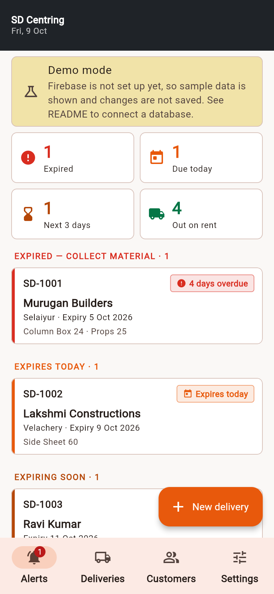
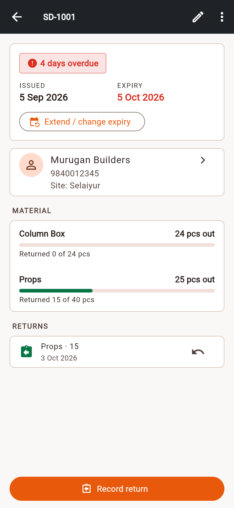
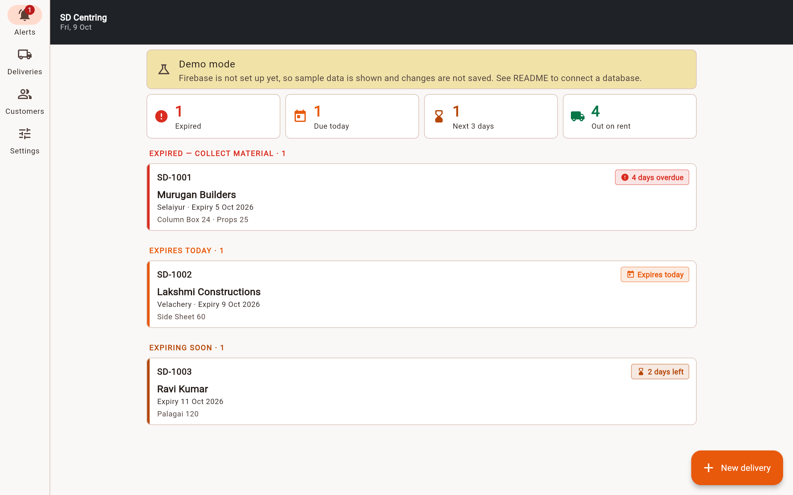

# SD Centring — rental expiry tracker

A Flutter app (Android, iOS, web) for SD Centring to track material sent to
customer sites and get **notified before rentals expire**. Unlike the PD
Centring app it has **no prices, totals, GST or invoices**: only who has what,
how much has come back, and when it is due back.

It is a separate app with its own code, database and look. Nothing is shared
with PD Centring.

| Phone | Delivery | Desktop |
|---|---|---|
|  |  |  |

## What it does

- **Alerts (home):** expired, due today, expiring soon and out-on-rent counts,
  with the deliveries that need action first.
- **Deliveries (DCs):** customer, site, delivery date, expiry date (quick
  picks: 7/15/30/45/60 days) and items with quantities. DC numbers are
  suggested automatically (`SD-1001`, `SD-1002`, …) and duplicates are refused.
- **Returns:** partial returns per item (e.g. 15 of 40 props), several at once,
  with a date and note. Any return can be undone. A delivery closes when
  everything is back.
- **Extend expiry:** every change is kept in a history.
- **Customers:** contact details, the material they currently hold, and their
  deliveries. Customers with deliveries cannot be deleted.
- **Reminders on the phone:** N days before expiry (1/2/3/5/7, set in
  Settings), on the expiry day, and the day after if material is still out.
  Each reminder fires at your chosen time. Tapping one opens that delivery.
  In the browser, use the Alerts tab instead.
- **Cloud sync status:** a banner says when changes are waiting to upload, when
  the phone is offline, or when the database refuses access. A failed save is
  never silent.

## Try it now (demo mode)

Until Firebase is connected the app runs in **demo mode** with sample data.
Nothing is saved in demo mode.

```bash
cd sd_centring
flutter pub get
flutter run            # phone / emulator
flutter run -d chrome  # browser
```

## Connect a database (one-time setup)

Use a **new Firebase project just for SD Centring**. Don't reuse PD Centring's.

1. Create a Firebase project, then enable **Authentication → Email/Password**
   and **Firestore Database** (choose *production mode*, not test mode).
2. In `sd_centring/`, run `flutterfire configure --project=<project-id>`.
   This replaces `lib/firebase_options.dart`.
3. Deploy the security rules: `firebase deploy --only firestore:rules`
   (rules are in `firestore.rules`).
4. Add each staff member:
   - **Authentication → Users → Add user** (email + password).
   - **Firestore → start collection `staff` → document ID = that user's UID**
     (any field, e.g. `name: "Owner"`). Accounts not in `staff` cannot read
     or write anything, even if they sign in.

There is no public sign-up screen. Accounts are created only by the owner.

## Business details

Name, phone, address, DC number prefix, first DC number, material names and
time zone are all in `lib/config/brand.dart`. Fill them in when SD Centring
provides them.

## Development

```bash
flutter analyze   # static checks
flutter test      # unit + widget tests (expiry, reminders, returns, forms, layouts)
```

CI (`.github/workflows/sd_centring.yml`) runs formatting, analysis, tests, a
web build and an Android build on every push that touches `sd_centring/`.

### Design decisions (lessons from the PD app)

- No secrets are bundled in the app, and there is no `.env` asset.
- Security rules live in the repo, have no expiry, and require a staff list.
- Items and returns are stored as real Firestore arrays, not JSON strings.
- Saves don't wait for the server, so the app never hangs offline. Failures
  are reported on screen.
- Dates are stored as calendar days (`yyyy-MM-dd`), so time zones can't shift
  an expiry by a day.
- Reminders are recalculated from the data on every change, so they never go
  stale or duplicate.
